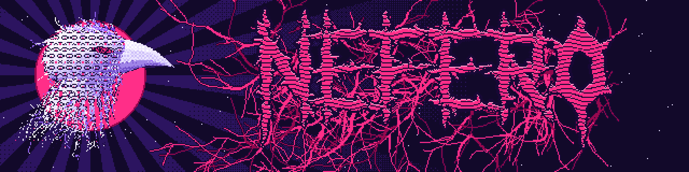
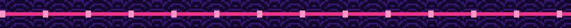
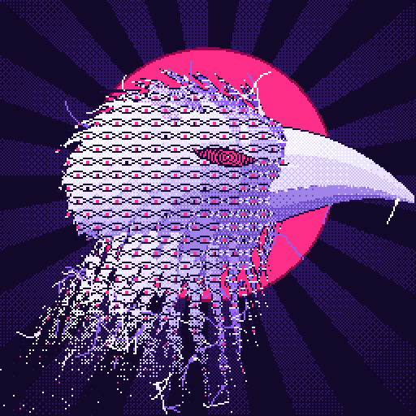

  

  

  <b>Kauã Neves</b> · game developer · lead director at <a href="https://www.instagram.com/hfts_ofc/"><b>HFTS Productions</b></a> 
  <i>small, strange games with big atmosphere</i>

  
  
  
  
  

<table>
<tr>
<td width="38%" align="center"></td>
<td>
<h3>Hi, I'm Kauã</h3>

I make <b>small, strange games with big atmosphere</b>: card tables at 3 AM, nights that never end, crows that stare back, and a lot of Brazil in everything. Pull up a chair. The coffee is cold, the dice are loaded, and the crow already knows your move.

<ul>
<li><b>Surreal games that keep <i>me</i> entertained first.</b> If I'm not hooked while building it, it doesn't ship.</li>
<li><b>Strategy</b>, with <b>a pinch of RPG in everything</b>: stats, choices, consequences.</li>
<li><b>Atmosphere over everything</b>: boteco lights, broken TVs, pixel art that feels like a PS1 fever dream.</li>
</ul>
</td>
</tr>
</table>

<b>🇧🇷 Ler em português</b>

Oi, eu sou o Kauã e faço **jogos pequenos e estranhos, com muito clima**: carteado às 3 da manhã, noites que não acabam, corvos que te encaram de volta e muito Brasil em tudo. Puxa a cadeira: o café tá frio, o dado tá viciado e o corvo já sabe a sua jogada.

- **Jogos surrealistas que me divertem primeiro.** Se eu não fico viciado fazendo, não sai.
- **Estratégia**, com **uma pitada de RPG em tudo**: atributos, escolhas, consequências.
- **Clima acima de tudo**: luz de boteco, TV chiando, pixel art com cara de sonho febril de PS1.

## HFTS Productions

I'm one of the creators of **HFTS Productions**, a Brazilian indie studio, and the **lead director** of our projects: game design, writing and direction, art and programming. Small team, big ideas, questionable sleep schedule.

| Game | |
|---|---|
| **[Saideira](https://hftsproductionsofc.itch.io/saideira)** | A first-person truco duel against a man in a hat who is not who he says he is. You both cheat. Whoever proves it first wins. |
| **Coiote's Dawn** | *Survive the day. Rule the night.* An adventure made with HFTS Productions. |
| **O Plano** | An interactive fiction you can play right in the browser. |

<b>🇧🇷 Ler em português</b>

Sou um dos criadores da **HFTS Productions**, estúdio indie brasileiro, e o **diretor principal** dos nossos projetos: game design, roteiro e direção, arte e programação. Equipe pequena, ideia grande, sono duvidoso.

- **Saideira**: truco de terror numa mesa de boteco, de madrugada. Os dois roubam; quem provar primeiro, ganha.
- **Coiote's Dawn**: *sobreviva o dia, domine a noite.*
- **O Plano**: ficção interativa para jogar no navegador.

## Cooking right now: Quórum

**Quórum** is a Brazilian political simulator set between 1985 and 2026. Start as a nobody running for city council and climb, vote by vote, all the way to the Planalto. Write laws, read the mood of Congress, build (and betray) coalitions, survive crises, scandals and the press, and win elections on a living map of Brazil. Strategy at its core, with that pinch of RPG: your career is your character sheet. Made in **Godot**.

<b>🇧🇷 Ler em português</b>

**Quórum** é um simulador político brasileiro de 1985 a 2026. Comece como um zé-ninguém concorrendo a vereador e suba, voto a voto, até o Planalto. Escreva leis, leia o humor do Congresso, monte (e traia) coalizões, sobreviva a crises, escândalos e à imprensa, e vença eleições num mapa vivo do Brasil. Feito em **Godot**.

## Around this GitHub

| Repo | |
|---|---|
| **[Power-PPlay](https://github.com/Kronohdev/Power-PPlay)** | PPlay 2.0, the framework used in the game development lab at Universidade Federal Fluminense. |
| **[DarkBlood-TTRPG](https://github.com/Kronohdev/DarkBlood-TTRPG)** | A tabletop RPG project. |
| **[Time_Flush](https://github.com/Kronohdev/Time_Flush)** | A Python game project. |
| **[Akuanduba](https://github.com/Kronohdev/Akuanduba)** | Traffic control model. |

   
  <i>Thanks for stopping by. The crow is watching.</i>

